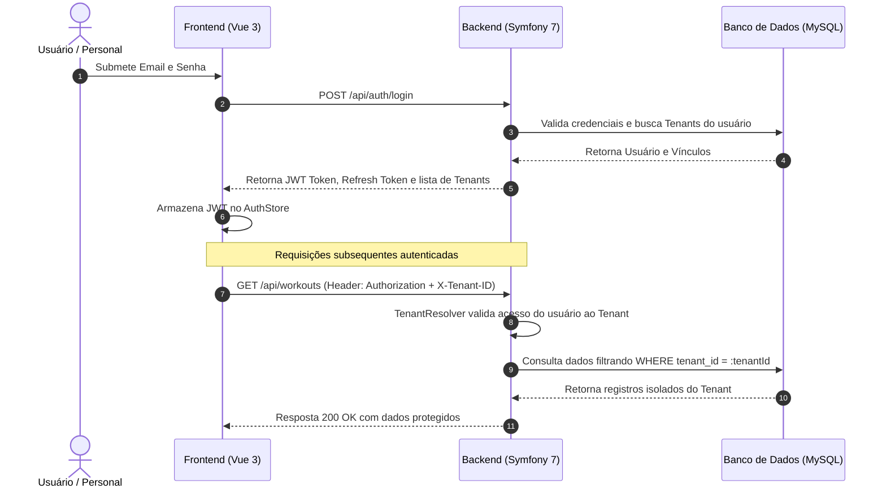

# 🏋️‍♂️ PersonalApp — SaaS Multi-Tenant para Personal Trainers e Assessorias Esportivas

> **Plataforma completa de gestão técnica, periodização de treinos, avaliações físicas, prontuário clínico e faturamento para profissionais de Educação Física e Assessorias.**

---

## 📌 Sumário
- [Visão Geral](#-visão-geral)
- [Arquitetura e Princípios de Engenharia](#-arquitetura-e-princípios-de-engenharia)
- [Módulos da Plataforma (Fases 01 a 16)](#-módulos-da-plataforma)
- [Stack Tecnológica](#-stack-tecnológica)
- [Estrutura do Repositório](#-estrutura-do-repositório)
- [Guia Rápido de Instalação e Execução](#-guia-rápido-de-instalação-e-execução)
  - [1. Pré-requisitos](#1-pré-requisitos)
  - [2. Configuração do Backend (API)](#2-configuração-do-backend-api)
  - [3. Configuração do Frontend (App)](#3-configuração-do-frontend-app)
- [Executando os Testes Automatizados](#-executando-os-testes-automatizados)
- [Políticas de Segurança e Variáveis de Ambiente](#-políticas-de-segurança-e-variáveis-de-ambiente)
- [Fluxo de Autenticação e Multi-Tenancy](#-fluxo-de-autenticação-e-multi-tenancy)

---

## 🌟 Visão Geral

O **PersonalApp** é um ecossistema SaaS desenhado sob medida para personal trainers autônomos, consultorias online, estúdios e assessorias esportivas com múltiplos treinadores. 

A plataforma cobre todo o ciclo de vida do aluno:
1. **Atração e Matrícula**: Planos comerciais de consultoria, cobranças avulsas ou recorrentes com controle de vencimentos e baixa de pagamentos (PIX, Cartão, Boleto).
2. **Triagem Inicial**: Questionários dinâmicos de anamnese de saúde e prontuário postural.
3. **Periodização e Prescrição**: Montagem de fichas divididas (A/B/C/D), templates reutilizáveis, biblioteca de exercícios com mídias e instruções.
4. **Execução em Tempo Real**: Módulo de treino ao vivo para registro de séries, repetições, carga (kg), RPE (esforço percebido) e descanso.
5. **Evolução Contínua**: Avaliações antropométricas, bioimpedância, gráficos temporais de dobras cutâneas e comparativos de volume de treino.
6. **Retenção Ativa**: Check-ins periódicos (sono, estresse, dor e dieta), metas quantitativas com barras de progresso e feed cronológico auditável.

---

## 🏗️ Arquitetura e Princípios de Engenharia

- **Isolamento Multi-Tenant Estrito**: O identificador da organização (`TenantContext`) é injetado automaticamente através do cabeçalho `X-Tenant-ID` ou resolvido via contexto de sessão. Nenhuma consulta ao banco de dados ocorre sem a clausula de tenant, impedindo qualquer vazamento cruzado de dados entre assessorias (*Tenant Leak Prevention*).
- **Controle de Acesso Baseado em Papéis (RBAC Granular)**:
  - `OWNER` / `ADMIN`: Gestão completa do tenant, treinadores, faturamento e planos.
  - `TRAINER`: Gestão de alunos vinculados, prescrição de treinos, anamnese e avaliações físicas.
  - `STUDENT`: Acesso restrito ao Portal do Aluno (suas fichas ativas, treinos ao vivo, histórico e check-ins).
  - `PLATFORM_ADMIN`: Superusuário com acesso ao console global de métricas, governança de tenants e trilha de auditoria.
- **Frontend Modular por Recursos (Feature-Driven Structure)**: Cada domínio funcional (`workouts`, `assessments`, `anamnesis`, `goals`, `financial`, etc.) possui seus próprios `pages`, `components`, `services` e `types`, garantindo manutenibilidade e escalabilidade.
- **Zero Placeholder & Estética Premium**: Design System moderno com Dark Mode nativo (paleta Slate-900/950, acentos em Esmeralda, Índigo, Âmbar e Rosa), microinterações fluidas e responsividade em dispositivos móveis e desktops.

---

## 🚀 Módulos da Plataforma

| Fase | Módulo | Descrição Funcional |
| :--- | :--- | :--- |
| **01 a 03** | **Fundação & Multi-Tenant** | Autenticação JWT, Refresh Tokens, Switch de Tenant, Perfil de Usuário e Gestão de Treinadores da Equipe. |
| **04 a 05** | **Exercícios & Catálogo** | Biblioteca de exercícios agrupados por grupo muscular, padrão de movimento, equipamentos e instruções. |
| **06** | **Templates & Fichas de Treino** | Construtor visual de fichas (divisões A/B/C...), periodização, volume de séries e prescrição para alunos. |
| **07** | **Execução ao Vivo (Live Workout)** | Modo treino ao vivo com cronômetro de descanso, ajuste de cargas reais, RPE e histórico de sessões. |
| **08** | **Avaliações Físicas & Métricas** | Antropometria (dobras cutâneas, perímetros corporais), bioimpedância e gráficos de evolução. |
| **09** | **Analytics & Retenção** | KPIs de portfolio (alunos sem ficha, risco de evasão 14d+), comparativo de volume de carga (kg) e Recordes Pessoais (PRs). |
| **10** | **Anamnese Configurável** | Construtor de questionários de triagem médica, aplicação e visualização de prontuários respondidos. |
| **11** | **Metas & Desafios** | Metas corporais quantitativas (peso, % gordura, cargas máximas), checkpoints e taxas de conclusão. |
| **12** | **Acompanhamento & Check-ins** | Formulários de feedback semanal (sono, energia, dor, dieta de 1 a 5), parecer do personal e tarefas. |
| **13** | **Linha do Tempo Auditável** | Feed cronológico unificado de treinos, avaliações, metas batidas e anotações clínicas com filtros. |
| **14** | **Financeiro da Consultoria** | Catálogo de planos de consultoria do personal, emissão de faturas, conciliação e baixa de mensalidades. |
| **15** | **SaaS Billing & Assinatura** | Planos da plataforma (Starter, Pro, Studio), controle de consumo de cotas de alunos e equipe. |
| **16** | **Platform Superadmin** | Painel global de infraestrutura, MRR da plataforma, moderação/bloqueio de tenants e trilha de auditoria. |

---

## 💻 Stack Tecnológica

### Backend (`api/`)
- **Linguagem / Framework**: PHP 8.2+ | Symfony 7.2 (FrameworkBundle, Security, Messenger)
- **Persistência / ORM**: Doctrine ORM 3.x | MySQL 8.0+ (Produção/Dev) | SQLite in-memory (Testes)
- **Segurança**: LexikJWTAuthenticationBundle, Hash de senhas com Argon2id/Bcrypt
- **Testes Automatizados**: PHPUnit 11 com 86 testes e 515 asserções

### Frontend (`app/`)
- **Linguagem / Framework**: TypeScript 5.x | Vue 3 (Composition API com `<script setup>`)
- **Build Tool**: Vite 6 com compilação ultrarrápida
- **Roteamento & Estado**: Vue Router 4 (Guards por papel e tenant) | Pinia 3
- **Estilização**: Tailwind CSS 3.4 com Flowbite e Lucide Icons

---

## 📁 Estrutura do Repositório

```text
personalapp/
├── api/                             # Backend Symfony 7
│   ├── config/                      # Configurações do framework e pacotes
│   ├── migrations/                  # Migrações versionadas do Doctrine
│   ├── src/
│   │   ├── Api/Controller/          # Controladores HTTP RESTful
│   │   ├── Application/Service/     # Serviços de aplicação e orquestração de negócios
│   │   ├── Domain/                  # Entidades, Enums e Regras de Domínio puras
│   │   └── Infrastructure/          # Repositórios Doctrine, Segurança e Storage
│   ├── tests/                       # Testes de integração, segurança e serviços
│   ├── phpunit.dist.xml             # Configuração da suíte de testes do PHPUnit
│   └── .env.example                 # Modelo de variáveis de ambiente do backend
│
├── app/                             # Frontend Vue 3 + TypeScript
│   ├── src/
│   │   ├── modules/                 # Módulos organizados por funcionalidade de negócio
│   │   │   ├── auth/                # Login e autenticação
│   │   │   ├── dashboard/           # Visão geral do treinador
│   │   │   ├── students/            # Gestão e prontuário completo de alunos
│   │   │   ├── workouts/            # Fichas, templates e treino ao vivo
│   │   │   ├── assessments/         # Avaliações físicas e evolução
│   │   │   ├── analytics/           # Indicadores e recordes de carga
│   │   │   ├── anamnesis/           # Construtor e respostas de anamnese
│   │   │   ├── goals/               # Metas corporais
│   │   │   ├── follow-up/           # Check-ins periódicos e cronogramas
│   │   │   ├── timeline/            # Feed auditável de eventos
│   │   │   ├── financial/           # Gestão financeira do personal
│   │   │   ├── saas-billing/        # Assinatura do espaço e cotas
│   │   │   ├── admin/               # Console Platform Superadmin
│   │   │   └── student-portal/      # Área exclusiva do aluno
│   │   ├── shared/                  # Componentes de UI, cliente HTTP e layouts
│   │   ├── stores/                  # Estado global (AuthStore, TenantStore)
│   │   └── router/                  # Mapeamento de rotas e guards de segurança
│   └── .env.example                 # Modelo de variáveis de ambiente do frontend
│
├── docs/                            # Documentação técnica e planejamento detalhado
├── .gitignore                       # Blindagem contra envio de segredos ao repositório
└── README.md                        # Documentação principal
```

---

## 🛠️ Guia Rápido de Instalação e Execução

### 1. Pré-requisitos
- **PHP 8.2+** com extensões: `pdo_mysql`, `pdo_sqlite`, `ctype`, `iconv`, `json`, `intl`, `mbstring`.
- **Composer 2.x**
- **Node.js 18+** e **npm**
- **Servidor MySQL 8.0+** (ou MariaDB compatível)

---

### 2. Configuração do Backend (API)

1. Acesse o diretório da API:
   ```bash
   cd api
   ```

2. Instale as dependências via Composer:
   ```bash
   composer install
   ```

3. Crie o arquivo de ambiente local a partir do modelo:
   ```bash
   cp .env.example .env
   ```
   > ⚠️ **Importante**: Ajuste a variável `DATABASE_URL` no `.env` para corresponder ao seu banco de dados MySQL local.

4. Crie a base de dados e execute as migrações:
   ```bash
   php bin/console doctrine:database:create --if-not-exists
   php bin/console doctrine:migrations:migrate --no-interaction
   ```

5. Inicie o servidor embutido do Symfony:
   ```bash
   symfony server:start --port=8000
   # Ou alternativamente via PHP nativo:
   php -S 127.0.0.1:8000 -t public
   ```
   *A API estará disponível em: `http://localhost:8000/api`*

---

### 3. Configuração do Frontend (App)

1. Acesse o diretório do frontend:
   ```bash
   cd ../app
   ```

2. Instale as dependências do Node.js:
   ```bash
   npm install
   ```

3. Configure o arquivo de ambiente local:
   ```bash
   cp .env.example .env
   ```

4. Inicie o servidor de desenvolvimento:
   ```bash
   npm run dev
   ```
   *A aplicação estará disponível em: `http://localhost:5173`*

---

## 🧪 Executando os Testes Automatizados

### Backend (PHPUnit)
A suíte de testes valida isolamento de tenants, fluxos de autenticação, permissões RBAC, cálculos de analytics, faturamento e regras de negócio:
```bash
cd api
vendor/bin/phpunit
```
> **Status**: `OK (86 tests, 515 assertions)` — 100% dos testes passando com zero falhas.

### Frontend (Type-Check & Build)
Valida a integridade dos tipos TypeScript e gera o bundle de produção:
```bash
cd app
npm run build
```
> **Status**: Compilação limpa com mais de 1.700 módulos transformados e zero erros no `vue-tsc`.

---

## 🔐 Políticas de Segurança e Variáveis de Ambiente

Para prevenir o vazamento de segredos e credenciais em ambientes compartilhados ou repositórios Git:
- **Regra de Blindagem**: Todos os arquivos `.env`, `.env.local`, `.env.dev` e `.env.test` são estritamente ignorados pelo Git via regras de negação (`!.env.example`).
- **Commits Seguros**: Apenas arquivos de exemplo com dados genéricos/placeholders (`.env.example`) são comitados.
- **Sanitização de Respostas**: Senhas e dados sensíveis utilizam atributos Doctrine ignorados na serialização JSON e senhas são criptografadas com algoritmos de derivação de chave de alta entropia.

---

## 🔑 Fluxo de Autenticação e Multi-Tenancy



---

## 👥 Papéis de Usuários e Contas para Teste

Ao inicializar o banco de dados com os seeders de desenvolvimento:
- **Superadmin da Plataforma**: `admin@platform.com` (Senha: `Admin@123`) — Acesso a `/admin/metrics`.
- **Personal Trainer (Owner)**: `treinador@personalapp.com` (Senha: `Trainer@123`) — Acesso ao Dashboard, Alunos, Treinos e Financeiro.
- **Aluno**: `aluno@personalapp.com` (Senha: `Student@123`) — Acesso ao Portal do Aluno em `/portal/home`.

---

## 📄 Licença
Este projeto é distribuído sob licença proprietária para uso no ecossistema SaaS PersonalApp. Todos os direitos reservados.
